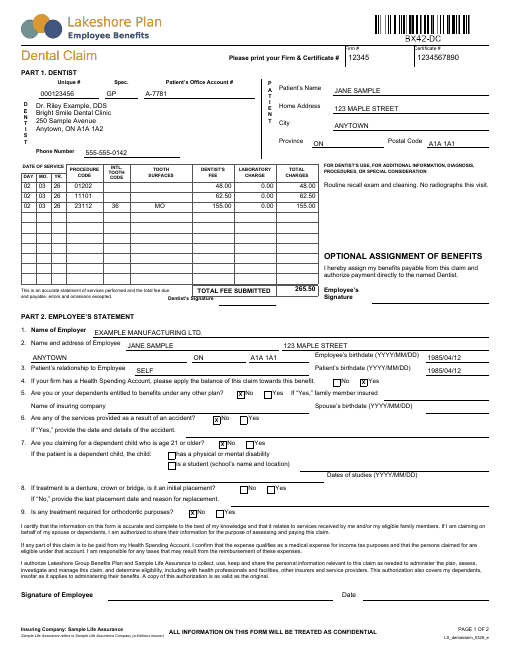

# Dental Claim

A two-page group-benefits dental claim form in the layout Canadian benefit plans commonly use.
It prints either blank, for a dentist and employee to fill in by hand, or pre-filled from data.

- **Page 1:** plan logo and a live Code 128 barcode of the form code. Firm and certificate
  boxes. **Part 1** covers the dentist: unique #, specialty, office account #, name/address,
  phone, and the patient's name and address. A 10-row procedure grid has a computed
  **Total Fee Submitted**, then a notes panel, an assignment of benefits, and signature lines.
  **Part 2** is the employee's statement: employer, employee and patient details, nine
  questions with Yes/No checkboxes, the declaration and authorization paragraphs, and the
  signature/date line.
- **Page 2:** instructions and the claims mailing address, plus an online-claims promo box.



## Data contract

All root fields are strings, and any of them may be empty (`""`) to leave that blank unfilled.

```json
{
  "PlanName": "...", "InsurerName": "...", "InsurerLegalName": "...",
  "FormCode": "BX42-DC", "FormRevision": "...",
  "ClaimsAddress": "line 1\nline 2", "Phone": "...", "Fax": "...", "Website": "...",
  "FirmNumber": "...", "CertificateNumber": "...",

  "DentistUniqueNo": "...", "DentistSpecialty": "...", "PatientAccountNo": "...",
  "DentistInfo": "name\nclinic\naddress...", "DentistPhone": "...", "DentistNotes": "...",
  "PatientName": "...", "PatientAddress": "...", "PatientCity": "...",
  "PatientProvince": "...", "PatientPostalCode": "...",

  "Employer": "...", "EmployeeName": "...", "EmployeeAddress": "...", "EmployeeCity": "...",
  "EmployeeProvince": "...", "EmployeePostalCode": "...", "EmployeeBirthdate": "YYYY/MM/DD",
  "PatientRelationship": "...", "PatientBirthdate": "YYYY/MM/DD",
  "HsaApply": "Yes|No|", "OtherCoverage": "Yes|No|", "FamilyMemberInsured": "...",
  "OtherInsurer": "...", "SpouseBirthdate": "...",
  "Accident": "Yes|No|", "AccidentDetails": "...",
  "DependentOver21": "Yes|No|", "ChildDisabled": "Yes|", "ChildStudent": "Yes|",
  "SchoolName": "...", "StudyDates": "...",
  "InitialPlacement": "Yes|No|", "PlacementDetails": "...", "Orthodontic": "Yes|No|",

  "Lines": [
    { "ServiceDate": "2026-03-02", "ProcedureCode": "01202", "ToothCode": "",
      "ToothSurfaces": "", "DentistFee": 48.00, "LabCharge": 0.00 }
  ]
}
```

- **Checkboxes:** a Yes/No question ticks **No** or **Yes** to match its value. Any other
  value, including `""`, leaves both boxes empty.
- **Procedure grid:** `ServiceDate` is an ISO date and splits into the DAY / MO. / YR.
  columns. Each line's total charge (`DentistFee + LabCharge`) and the grand total are
  computed. The grid is ruled for 10 lines and doesn't move the rest of the page as lines
  are added. More than 10 lines will overflow it, so split larger claims across forms.
- **Blank form:** pass `"Lines": []` and empty strings.

See [`sample-data.json`](sample-data.json) for a filled-in example. The plan, insurer,
dentist, people, addresses and numbers in it are all fictitious, and the declaration text is
generic sample wording, not any real insurer's.

## Requirements

The form-code barcode is a `BarCode128` `<CustomReportItem>`, so the host app must reference
`Majorsilence.Reporting.RdlCri` (as RdlCmd, RdlReader and the designer already do). To drop
that dependency, delete the `FormBarcode` item from the page header.

The plan logo is a fictitious PNG embedded as `PlanLogo`. Replace its `<ImageData>` with your
own base64 PNG. The slot is 2.35in x 0.41in and scales the image proportionally.

## Render it

Same pattern as the [Invoice](../invoice) template -- see its README for the full snippet.
Substitute `dental-claim.rdl` and your own data (same shape).
