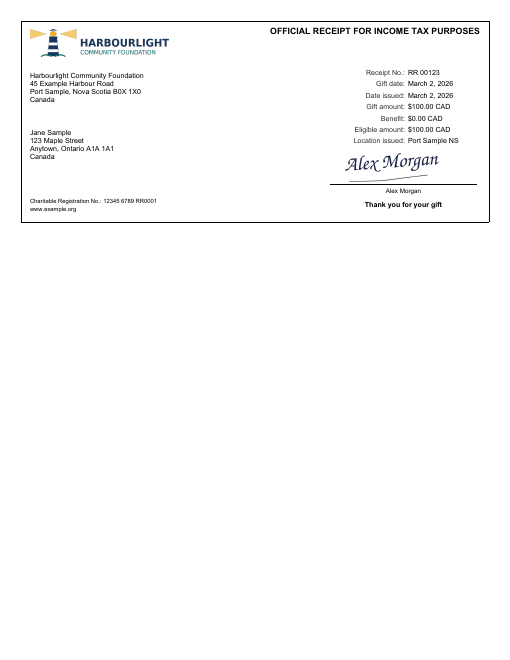

# Donation Receipt

An official charitable donation receipt for income tax purposes, in the layout Canadian
registered charities commonly use: charity logo and address, donor name and address, receipt
number, gift/issue dates, gift amount, benefit (advantage) received and the resulting eligible
amount, location issued, and a signature block. The receipt sits in a bordered box at the top
of a letter-size page, and each receipt in the data prints on its own page, so one run can
produce a whole batch.



## Data contract

```json
{
  "CharityName": "...",
  "CharityAddress": "line 1\nline 2\n...",
  "RegistrationNumber": "12345 6789 RR0001",
  "Website": "www.example.org",
  "LocationIssued": "...",
  "SignerName": "...",
  "Currency": "CAD",
  "ThankYou": "Thank you for your gift",
  "Receipts": [
    { "ReceiptNumber": "RR 00123", "DonorName": "...", "DonorAddress": "line 1\nline 2\n...",
      "GiftDate": "2026-03-02", "DateIssued": "2026-03-02",
      "GiftAmount": 100.00, "BenefitAmount": 0.00 }
  ]
}
```

Dates are ISO strings and print as `March 2, 2026`. The eligible amount is computed as
`GiftAmount - BenefitAmount`. See [`sample-data.json`](sample-data.json) for a complete example
-- the charity, people, addresses and registration number in it are all fictitious.

## Logo and signature

Both are fictitious PNGs embedded in the RDL (`CharityLogo` and `Signature` under
`<EmbeddedImages>`), so the template stays a single file. Replace their `<ImageData>` with your
own base64 PNGs, or switch the `Logo`/`Signature` images' `<Source>` to `External` and point
`<Value>` at a file or URL. The logo slot is 2.3in x 0.45in and the signature slot 1.9in x
0.48in; both scale proportionally.

Check your tax authority's current receipt requirements before using this for real receipts
(for example, the CRA also requires its name and website address, which you can add as a
line of text).

## Render it

Same pattern as the [Invoice](../invoice) template -- see its README for the full snippet.
Substitute `donation-receipt.rdl` and your own data (same shape).
