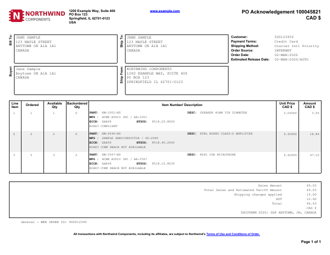

# Order Acknowledgement

A distributor-style sales order acknowledgement on landscape letter paper: vendor letterhead,
bordered Bill To / Ship To / Buyer / Ship From boxes with rotated labels, an order-details
block, a line-item table whose description cell stacks part number, manufacturer, export
classification (ECCN/HTSUS) and notes, and a totals box with shipping and sales tax.



## Data contract

```json
{
  "AckNumber": "100045821",
  "Currency": "CAD $",
  "VendorName": "...",
  "VendorAddress": "line 1\nline 2\n...",
  "VendorWebsite": "www.example.com",
  "BillTo": "...", "ShipTo": "...", "Buyer": "...", "ShipFrom": "...",
  "CustomerNumber": "...", "PaymentTerms": "...", "ShippingMethod": "...",
  "OrderSource": "INTERNET", "OrderDate": "02-MAR-2026", "EstimatedRelease": "...",
  "EstimatedTariff": 0.00,
  "ShippingCharges": 15.00,
  "TaxLabel": "HST",
  "TaxRate": 0.15,
  "Incoterm": "...",
  "WebOrderId": "...",
  "TermsText": "...", "TermsLinkText": "...", "TermsUrl": "https://...",
  "Lines": [
    { "LineNumber": 1, "Ordered": 1, "Available": 1, "Backordered": 0,
      "PartNumber": "NW-1001-ND", "Manufacturer": "...", "MfgPartNumber": "...",
      "Description": "...", "Eccn": "EAR99", "Htsus": "8518.29.8000",
      "Notes": "...", "UnitPrice": 3.09 }
  ]
}
```

Address fields are multi-line strings (`\n` separated). Line amounts (`Ordered * UnitPrice`),
the sales subtotal, tax (`(sales + tariff + shipping) * TaxRate`, rounded to cents) and the
grand total are all computed in the report. See [`sample-data.json`](sample-data.json) for a
complete example -- all names, addresses and numbers in it are fictitious.

## Logo

The "Northwind Components" logo is a fictitious PNG embedded in the RDL as the
`CompanyLogo` `<EmbeddedImage>` (base64), so the template stays a single file. To use your
own, replace its `<ImageData>` with your PNG's base64 (or change the `Logo` image's
`<Source>` to `External` and point `<Value>` at a file or URL). The slot is 1.86in x 0.4in
and scales the image proportionally.

## Render it

Same pattern as the [Invoice](../invoice) template -- see its README for the full snippet.
Substitute `order-acknowledgement.rdl` and your own data (same shape).
