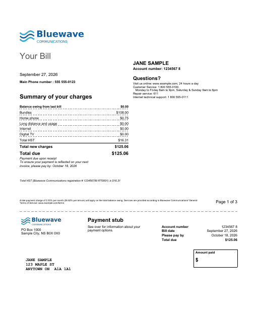

# Telecom Bill

A multi-page phone/internet/TV bill in the style Canadian telecom providers use.

- **Page 1:** the provider's logo, "Your Bill", the customer name, account number, bill date
  and main phone number, a contact block, and a **Summary of your charges**: balance from
  the last bill, one line per service section, total tax, total new charges and total due.
  Below that are the tax registration and late-payment notes and a dashed cut line with a
  **payment stub**: remittance address, account/date/due summary, an "Amount paid" box, and
  the customer's mailing address in window-envelope position.
- **Page 2 onward:** a running header (logo, customer, account number, bill date) and the
  **Balance from your last bill**. Then one section per service, each with a grey title bar,
  "Charges for <number>", the billing period, the charge lines, the section total and the
  section tax. An optional "includes" panel sits on the right. The bill ends with
  **Bill payment options** and the remittance address.



## Data contract

```json
{
  "ProviderName": "...", "ProviderRemitAddress": "line 1\nline 2", "Website": "...",
  "ContactInfo": "multi-line text for the Questions? block",
  "TaxName": "HST", "TaxRate": 0.15, "TaxRegistration": "...", "LateFeeText": "...",

  "CustomerName": "...", "MailingAddress": "line 1\nline 2",
  "AccountNumber": "...", "MainPhone": "...",
  "BillDate": "2026-09-27", "PayBy": "2026-10-18",
  "PreviousAmountDue": 125.06, "PaymentReceived": 125.06, "PaymentDate": "2026-09-11",

  "Sections": [
    { "Code": "BUNDLE", "Name": "Bundles", "SortOrder": 1,
      "ChargesFor": "555 555-0123", "Period": "Aug 28 to Sep 27",
      "Includes": "optional multi-line text, or \"\"" }
  ],
  "Charges": [
    { "Section": "BUNDLE", "Description": "...", "Amount": 263.00 }
  ]
}
```

Each charge belongs to a section through `Section` = `Code`. The report pulls the section's
name, period and so on with `Lookup()`, and orders sections by `SortOrder`. A section with no
charges doesn't print.

Calculated in the report:

- **Section total:** the sum of its charges.
- **Section tax:** `Round(section total * TaxRate, 2)`.
- **Total tax:** `Round(all charges * TaxRate, 2)`. With several sections it can differ by a
  cent from adding up the rounded section taxes. If your billing system rounds per section,
  supply the tax amounts instead.
- **Balance from last bill:** `PreviousAmountDue - PaymentReceived`.
- **Total due:** balance + new charges + tax.

Dates are ISO strings.

See [`sample-data.json`](sample-data.json) for a complete example. The provider, customer,
account and phone numbers, addresses, plan names and tax registration in it are all
fictitious.

## Notes

- **Logo:** the logo is a fictitious PNG embedded as `ProviderLogo`. It's used on page 1, the
  stub and the running header. Replace its `<ImageData>` with your own base64 PNG.
- **Section order:** a List orders its groups by its group expression; `<Sorting>` only breaks
  ties. So the sections list groups on the zero-padded `SortOrder` followed by the code.
- **Payment stub position:** the summary sits in a fixed-height box, so the stub stays put
  with up to about ten sections.

## Render it

Same pattern as the [Invoice](../invoice) template -- see its README for the full snippet.
Substitute `telecom-bill.rdl` and your own data (same shape).
